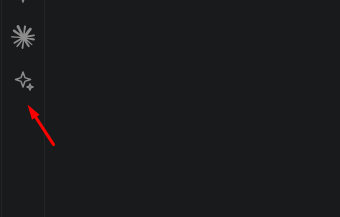

p# improve-prompt

A Claude Code mod that rewrites your prompt before you send it, using what the session already knows: the conversation so far, your `CLAUDE.md`, and the project's git status.

Type a quick, rough prompt, press **✨ Improve prompt**, and the prompt box is filled with a clearer version. You review it and send it yourself.

```
before:  fix the login bug
after:   Fix the login bug in src/auth/session.ts where expired tokens are not
         refreshed. Keep the existing API. Verify by running npm test -- auth.
```

## What it does

- Keeps your intent and your language. A prompt written in Portuguese comes back in Portuguese.
- Spells out the goal, the files involved, constraints, and how to check the work is done, where that helps.
- Never invents requirements and never widens the scope.
- Never sends anything for you. The rewrite lands in the prompt box for you to edit or discard.

## Install

Mods are installed with Claude Code's `plugin` commands, so you'll see "plugin" in the steps below.

At the prompt of a Claude Code terminal session:

```
/plugin install improve-prompt --marketplace waltherhuggo/PromptEnhancer
```

Answer `y` to add the marketplace, then press Enter to pick the user scope.

From a shell:

```
claude plugin install improve-prompt --marketplace waltherhuggo/PromptEnhancer
```

In the VS Code extension, where `/plugin` does not run, use the shell command above in a terminal.

In the desktop app, where `/plugin` does not run either: click **+** next to the prompt box, then **Plugins**, then **Add marketplace** with `waltherhuggo/PromptEnhancer`, then **Add plugin**.

Prefer not to install it? Copy this repo's [`.claude/skills/improve-prompt/`](.claude/skills/improve-prompt) folder into your project's `.claude/skills/` (or `~/.claude/skills/` to use it in every project). Claude Code loads it from there automatically.

## Usage

**Button:** type a prompt, then press **✨ Improve prompt** above the prompt box.

**Command:**

```
/improve fix the login bug
```

Run `/improve` with no text and it improves whatever is already in the prompt box.

**VS Code sidebar (optional):** the [`vscode/`](vscode) folder holds a small extension that adds a ✨ **Improve prompt** button to the activity bar. It rewrites the selected text (or your clipboard) with the context of your last Claude session and copies the result, so you can paste it into the chat with Ctrl+V. It needs the mod installed. To install the extension:

```
code --install-extension vscode/improve-prompt.vsix
```

## How it works

The mod forks the current conversation, so the model sees the same context you do, and asks it to rewrite your draft. In a brand-new session there is nothing to fork, so it falls back to a plain Sonnet call. Only one rewrite runs at a time, and the button hides while Claude is working.

## Development

This mod was created inside Claude Code. Open the ✨ icon in the sidebar and describe the mod you want:



To check your changes:

```
claude plugin validate .
claude plugin test .claude/skills/improve-prompt
```

In this repo the mod loads automatically from `.claude/skills/improve-prompt/`.

## License

[MIT](LICENSE)
